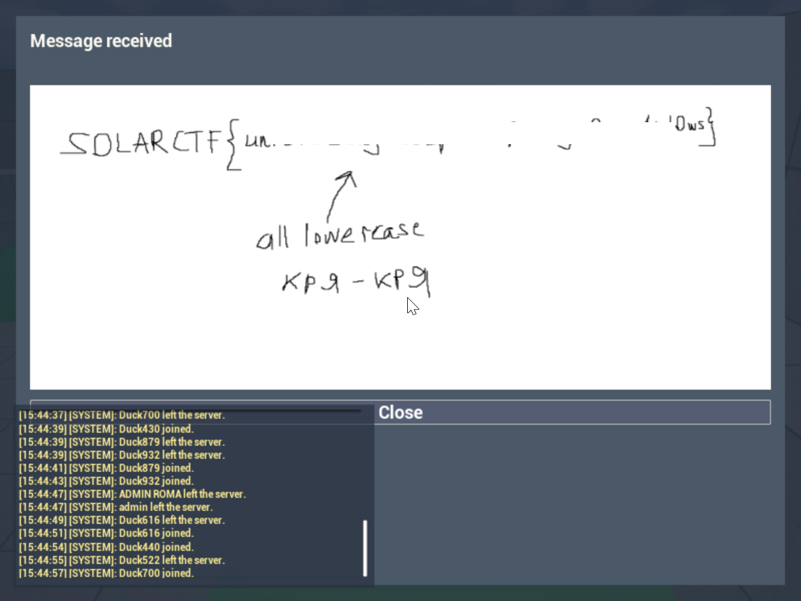

# Unreal Duck: the path to the solution

## 0. The whole plan

Why this section: so the reader sees the chain down to the details and understands why every next
step is needed.

Given: a Windows client of a game on Unreal Engine 5.7, a folder of content containers, a launcher
and a live multiplayer server. There are no project sources. The game hides logic that hands out a
reward after certain actions.

Goal: understand what has to be done in the game and get the flag.

The plan was this:

1. Record the build composition and file hashes, so every later address refers to a known version.
2. Understand what reads the content containers, and unpack them.
3. Look at the assets and check whether the logic is there.
4. Find the game logic in the executable: network function names and their addresses.
5. Attach to the running client and see which fields change during play.
6. Reconstruct the code check math and verify it against values taken from the live game.
7. Brute-force the code locally.
8. Enter the found codes the normal way, wait for the reward and read the flag.

## 1. What is given

Why this step: to pin down the input files and their checksums, because every address and offset
below belongs to exactly this build.

The archive unpacks with plain `unzip`, then I look at file types and the hash of the main one:

```
$ unzip -l unreal_duck.zip
$ unzip -q unreal_duck.zip -d unreal_duck
$ file unreal_duck/UnrealDuck/Binaries/Win64/UnrealDuckClient-Win64-Shipping.exe
... PE32+ executable (GUI) x86-64, for MS Windows
$ sha256sum unreal_duck/UnrealDuck/Binaries/Win64/UnrealDuckClient-Win64-Shipping.exe
d0aff10fbd7e980dc9edcaa8cc95d232a37b11c7eb977ad9e66784cec532b802
```

I took the sizes with `stat`, so every address below belongs to a verified build. The launcher
`UnrealDuckClient.exe` is 167 424 bytes and is PE64 too. The main code is in
`Binaries/Win64/UnrealDuckClient-Win64-Shipping.exe`, 143 861 760 bytes, PE64 x86-64. The content
sits in `Content/Paks`: IoStore data `UnrealDuck-WindowsClient.ucas` takes 289 910 624 bytes, the
index `UnrealDuck-WindowsClient.utoc` takes 217 399 bytes, the separate
`UnrealDuck-WindowsClient.pak` takes 11 017 197 bytes. The engine pair is smaller: `global.utoc` is
722 bytes and `global.ucas` is 2 870 272 bytes.

The hash helped later: the first attempt to place a hook ended with `access violation`, and
checking the module name, its base and the function bytes removed the uncertainty (section 6).

## 2. Containers: the IoStore index and the pak

Why this step: to learn how many packages are inside, which compression they use, and whether the
pak holds anything, because that decides what to unpack and with which tool.

The file sizes immediately hint at which is which: an index of 217 KB next to 290 MB of data looks
like a table of contents plus content. That is a guess though, so I googled the extensions `.utoc`
and `.ucas`. The search leads to the Epic documentation on IoStore: it is an Unreal container
where `utoc` holds the index (a table of chunks and a list of packages) and `ucas` holds the data,
and the two files only work as a pair. The `global` pair is shared engine data, the
`UnrealDuck-WindowsClient` pair is the game content. A `.pak` file is the older Unreal container,
it sits next to them, and it has to be checked too so that no part of the content is missed.
Ready-made tools exist for both formats: `retoc` for IoStore and `repak` for pak.

I start with the index because it is the table of contents of the container: without it there is no
way to list assets or learn the compression. To compare the layout with the format description I
dump the first bytes of the file:

```
$ head -c 32 UnrealDuck/Content/Paks/UnrealDuck-WindowsClient.utoc | xxd
00000000: 2d3d 3d2d 2d3d 3d2d 2d3d 3d2d 2d3d 3d2d
00000010: 0800 0000 9000 0000 0100 0000 2c00 0000
```

The first sixteen bytes are the string `-==--==--==--==-`. At first I took it for a banner at the
start of the file, until I googled the IoStore header description. In the format this is the
signature field of `FIoStoreTocHeader`, and it sits exactly at offset zero. The second file proves
it: `global.utoc` starts with the same sixteen bytes `2d3d 3d2d 2d3d 3d2d 2d3d 3d2d 2d3d 3d2d`.
Then version `08 00 00 00` sits at offset `0x10`, header size `90 00 00 00`, that is 144 bytes, at
`0x14`, and every following field agrees.

Then, instead of parsing the index by hand, I hand it to `retoc`. First the summary:

```
$ retoc info UnrealDuck/Content/Paks/UnrealDuck-WindowsClient.utoc
  container_flags: EIoContainerFlags(Compressed | Indexed)
  version: ReplaceIoChunkHashWithIoHash
  mount_point: ../../../
  chunks: 2126
  packages: 504
  compression_methods: [Oodle]
```

The summary answers two questions at once. The package count of 504 means this is not a monolith
but 504 separate assets, so the search will go by name rather than by offset in a file. The
`Oodle` compression means unpacking needs a tool that supports this codec: plain `unzip` gets
nothing here.

To see what those 504 packages consist of, I read the index line by line:

```
$ retoc list UnrealDuck/Content/Paks/UnrealDuck-WindowsClient.utoc | head -3
UnrealDuck-WindowsClient 7aba7a84b764bf1300000001 ExportBundleData
UnrealDuck-WindowsClient 8efe6173efa8192200000001 ExportBundleData
UnrealDuck-WindowsClient 6ff734fd30628e8c00000002 BulkData
```

What this means. A chunk is a storage unit inside IoStore, with an identifier and a type. Type
`ExportBundleData` is asset data, `BulkData` is large nested data such as textures, `ShaderCode`
is shaders. A package is the logical unit corresponding to one asset. `retoc list` prints only
chunk identifiers, but the index does carry names: the header has a
separate name size field (`namelen 32`) and a separate directory, and my script
`scripts/unrealduck_utoc_index.py` reads it directly and gets 142 directories, 635 files and 745
name table entries. That path list is what `assets/unrealduck_paths.txt` holds.

Now the pak. The number of entries says nothing on its own, so I look not at how many files are
inside but at which ones:

```
$ repak list UnrealDuck/Content/Paks/UnrealDuck-WindowsClient.pak | cut -d/ -f1 | sort | uniq -c
   1652 Engine
     10 UnrealDuck

$ repak list UnrealDuck/Content/Paks/UnrealDuck-WindowsClient.pak | grep '^UnrealDuck/'
UnrealDuck/AssetRegistry.bin
UnrealDuck/Config/DefaultEngine.ini
UnrealDuck/Config/DefaultGame.ini
UnrealDuck/Config/DefaultInput.ini
UnrealDuck/Content/ShaderTypeInfo-Global-PCD3D_SM5-PCD3D_SM5.stinfo
UnrealDuck/Content/ShaderTypeInfo-Global-PCD3D_SM6-PCD3D_SM6.stinfo
UnrealDuck/Content/ShaderTypeInfo-UnrealDuck-PCD3D_SM5-PCD3D_SM5.stinfo
UnrealDuck/Content/ShaderTypeInfo-UnrealDuck-PCD3D_SM6-PCD3D_SM6.stinfo
UnrealDuck/Plugins/UnrealDuck.upluginmanifest
UnrealDuck/UnrealDuck.uproject
```

The conclusion: the pak holds engine configs, a shader cache and `AssetRegistry.bin` (a registry
listing asset paths), but no game assets at all. So the thing to unpack is IoStore, and the pak is
only good for taking the configs and the registry.

A separate find in the config: `DefaultEngine.ini` contains `CoreRedirects`, a rename table where
some property names are replaced with Greek trigrams. For `DuckRouteRecord`, for instance, the
original names look like `N4 I2 E0 P7 X1 K5 D3 V6`. Sorted by the numeric suffix they become
`E0 X1 I2 D3 N4 K5 V6 P7`, that is `EXIDNKVP`. I tried A1Z26, ROT and index sums, but none gave a
provable result, so I stopped that line (section 13).

## 3. Unpacking and what the assets give

Why this step: while the content is in IoStore it cannot be read as ordinary files, and the assets
have to yield object names and level structure.

The order is this. First `retoc to-legacy` converts IoStore back into classic `.uasset` and
`.umap` plus `.uexp`, the form Unreal used before Zen. Then `repak unpack` unpacks the pak. All of
it is wrapped in `scripts/duck_extract.sh`:

```
$ ./scripts/duck_extract.sh UnrealDuck/Content/Paks out
[retoc] UnrealDuck-WindowsClient
[repak] UnrealDuck-WindowsClient
```

After unpacking, the index gives 635 files in the container tree. The script prints them the way
they are stored inside, together with the chunk number:

```
1712 ../../../UnrealDuck/Content/ThirdPerson/Lvl_ThirdPerson.umap
  95 ../../../UnrealDuck/Content/Menu/Lvl_MainMenu.umap
1629 ../../../UnrealDuck/Content/ThirdPerson/Blueprints/BP_ThirdPersonPlayerController.uasset
1827 ../../../UnrealDuck/Content/ThirdPerson/Blueprints/BP_ThirdPersonGameMode.uasset
1649 ../../../UnrealDuck/Content/ThirdPerson/Blueprints/BP_ThirdPersonCharacter.uasset
```

In Unreal editor terms the project root `UnrealDuck/Content` corresponds to `/Game`, so below I
call these objects shortly, for example `/Game/ThirdPerson/Lvl_ThirdPerson`. The full list is in
`assets/unrealduck_paths.txt`, the project-only list in `assets/unrealduck_project_assets.txt`.

The build has one game map, the training ground `/Game/ThirdPerson/Lvl_ThirdPerson`. The second map
file, `Lvl_MainMenu`, is the menu screen, and a menu is not a level. The executable string says the
same, it describes exactly one public level:

```
Current public level. Additional routes may appear later
without exposing their map paths in the menu.
```

Next to it I found the level list initialisation at `VA 0x144380A20`: it creates one entry
`training_ground`, sets `bVisibleInMenu=1` and points to `/Game/ThirdPerson/Lvl_ThirdPerson`.

The unpacked files can already be opened, but this is a binary format, so I googled its
description. A classic Unreal package starts with `FPackageFileSummary`, which holds the name
table `NameMap` and the export map `ExportMap`. Following that description I wrote the parser in
`scripts/duck_map_layout.py`. The script reads the magic `0x9e2a83c1`, checks the package version,
extracts names and exports, and writes `layout.json` and `names.txt`:

```
$ python3 scripts/duck_map_layout.py out/legacy_assets/.../Lvl_ThirdPerson.umap --out dkl
$ head -5 dkl/names.txt
```

The summary shows `legacy: -9`, `cooked: True` and `uses_unversioned_properties: True`. A negative
legacy version means UE5, and `unversioned` means property names are not written into the file, so
they cannot be read as plain text without class descriptions.

The content tree keeps producing files with the `BP_` prefix, and they deserve a stop. A blueprint
is the way to write game logic in Unreal without C++: you build a graph of nodes in the editor, and
the result is stored as an ordinary asset with the `BP_` prefix. I learned this when I googled what
the files like `BP_ThirdPersonPlayerController.uasset` in `Content/ThirdPerson/Blueprints` are, and
why there is no program text inside such a file.

The blueprints look the same as the map: `BP_ThirdPersonPlayerController` has
`UnrealDuckPlayerController` in its name table, and `BP_ThirdPersonGameMode` has
`UnrealDuckGameMode`. So a blueprint inherits a native C++ class. The class name in the name table
alone does not prove there is no logic in the blueprint: only the executable analysis below shows
that.

A side check: can the answer be extracted from the level geometry. In `Lvl_ThirdPerson.umap` and
`.uexp` I recovered the export list and about 55 `StaticMeshComponent` components, 53 of them game
blocks: roughly 20 cubes, 12 ramps, 9 cylinders and 12 quarter cylinders. Coordinates are in the
`XY ±2000` range, heights mostly `0`, `-100` and `200`, rotations multiples of 90 degrees. To read
the serialised transforms I matched four component layouts, judging them by whether the values made
sense. The layouts came out like this. With a component size of 113 bytes, `RelativeLocation` is read at
offset +21, `RelativeRotation` at +45 and `RelativeScale` at +69. With 102 bytes it is +10, +34 and
+58. With 91 bytes only +23 and +47 remain, there is no rotation in the record. With 80 bytes it is
+12 and +36, again with no rotation.

That confirmed the arena is read correctly, but there is no plain flag text in the arrangement of
the blocks. The scripts for it stayed in `scripts/duck_smc_decode.py`,
`scripts/duck_umap_probe.py` and `scripts/duck_umap_fixmap.py` as supporting material.

## 4. Network function strings and their addresses

Why this step: to find the code that sends data during play, one has to find function names first
and then turn the names into addresses.

A string search across the main executable gives the game controller function names:

```
$ strings -a UnrealDuckClient-Win64-Shipping.exe | grep -E 'Server|Client'
ServerPushCheatLetter
ServerRecordFrame
ServerApplyLocalProfile
ServerSendChat
ClientReceivePayload
ClientResetChallengeAfterDeath
```

In Unreal such functions are declared as `UFunction` and called through the reflection system and
`ProcessEvent`. That leads to an easy mistake: a function name in `.rdata` is not the address of
its handler. To get the code I looked for registration tables of the form "name pointer, `exec...`
wrapper pointer" and for the virtual table of the game `PlayerController`.

The resulting addresses for this build (virtual addresses, image base `0x140000000`) are these.
The `exec` wrappers of the server functions are at `ServerPushCheatLetter` `0x144383940`,
`ServerRecordFrame` `0x1443839C0`, `ServerApplyLocalProfile` `0x144383860` and
`ClientReceivePayload` `0x144382C50`. The client side sends go through `0x144381D30` for
`ServerPushCheatLetter`, `0x144381D70` for `ServerRecordFrame` and `0x144381E30` for
`ServerSendChat`.

The route logic sits at these addresses: letter key handling `0x14438F5F0`, route activation zone
entry `0x144391670`, route completion zone entry `0x144391890`, route check value computation
`0x14438B8A0`, overall completion check `0x144395F10`.

The reward and the interface: the `ClientReceivePayload` implementation is `0x144394600`, the
received message UI is `0x144393210`, the menu level list creation is `0x144380A20`.

I verify the addresses with a disassembler so I am not working from random offsets:

```
$ objdump -d -M intel --start-address=0x14438B8A0 --stop-address=0x14438C000 UnrealDuckClient-Win64-Shipping.exe
$ objdump -d -M intel --start-address=0x144395F10 --stop-address=0x144396080 UnrealDuckClient-Win64-Shipping.exe
$ objdump -d -M intel --start-address=0x144394600 --stop-address=0x144394780 UnrealDuckClient-Win64-Shipping.exe
```

Then I tried the most direct route: the server functions exist, so reverse them and read the check.
That did not work, and here is why. In the virtual table starting at `VA 0x147118AA0` the slots look
like this: offset `+0xF98` holds `0x141128770`, `+0xFA0` holds `0x141128770` too, `+0xFB0` holds
`0x1443937F0`, and `+0xFC8` holds `0x14438B400`, which leads to `0x144394600`. The value
`0x141128770` is an empty handler of a single `ret`.

That is expected: server RPCs are empty in the client build, the check runs in a separate server
build that is not in the archive. But the client computes the route check value itself and shows
its own progress state, so the logic can be studied locally without touching the server.

## 5. UDP: why that direction did not help

Why this section: to explain why writing a custom network client was not worth it.

The server address is in the config, and it answers UDP `PING` with short binary packets starting
with `f0 81 01`. But I could not confidently match those replies to the game RPCs, and sending
ASCII strings does not replace the stock `NetDriver` anyway: that needs a handshake, actor channels
and `ProcessEvent`. On top of that, the ordinary Windows client already connected to the shared
arena, so checking events in a live client is simpler than reimplementing the protocol.

## 6. Frida: attaching and the first error

Why this step: the disassembler shows the functions exist, but not which controller fields they
read and in which order they are called. That is faster to see at runtime.

I looked for a way to intercept calls in someone else's process by reading what tools people
usually use for it. That is how I found Frida, which attaches to a running process and places
hooks by address. The hook has to go on `UnrealDuckClient-Win64-Shipping.exe`, not on the
launcher.

```
py -m pip install frida
py scripts/duck_frida_guarded.py --exe "C:\path\to\UnrealDuckClient-Win64-Shipping.exe" --out duck_payloads
```

The first version of the hook failed immediately with a memory read error:

```
access violation accessing 0x7fff6db44600
```

I did not establish the exact cause, so instead of guessing I added checks:
`Process.enumerateModules()`, module lookup by exact name, a check that `RVA < module.size`,
`Process.findRangeByAddress`, an executable page check and a machine code signature comparison.
For the reward receiver it came out like this:

```
ClientReceivePayload_Impl VA = 0x144394600
RVA = 0x04394600
signature = 40 55 56 57 48 83 EC 40 F6 81 48 03 00 00 02 49 8B F0 48 8B EA 48 8B F9
```

After that Frida confirmed the module and the signature were right and the hook was in place. But
during a normal walk around the arena not a single `ClientReceivePayload` call arrived, so the
reward does not come for free.

## 7. Ordinary walking is recorded as letter input

Why this step: to understand what the game counts as code input, otherwise there is no way to
explain where the accumulated characters come from.

The log showed three different send functions, not one shared chat command.
`ServerPushCheatLetter` has wrapper `0x144381D30` and its caller is `0x14438F77A`.
`ServerRecordFrame` has wrapper `0x144381D70` and its caller is `0x14438BA6A`. `ServerSendChat` has
wrapper `0x144381E30` and its caller is `0x144394F49`.

`ServerPushCheatLetter` takes a number from 0 to 25: key `A` gives 0, `B` gives 1 and so on. The
game listens to Latin keys not only while the chat is open, so the log was full of `0`, `3`, `18`,
`22`. That is ordinary `WASD` movement: `A` gives 0, `D` gives 3, `S` gives 18, `W` gives 22.

With an active route the same events went into the accumulated letters array. If you drive through
the start and finish zones without typing anything on purpose, the log shows:

```
RouteActivation routeId=0/1/2
RouteCompletion routeId=0/1/2
RouteRPC routeId=0 codesCount=0
```

A separate experiment showed that letters really are recorded. I deliberately pressed five
different keys in a row without walking around: `D`, then `W`, then `D`, then `D`, then `F`. The
log shows the counter growing from one to five, which letters accumulated, and that the lock
engaged after the fifth one:

```
codesCount 1 -> 2 -> 5
codes = [D, W, D, D, F]
locked = 1
RouteRPC routeId=0 codesCount=5
```

The `codesCount` and `codes` lines are printed by the hook in `scripts/duck_auto_guide.py`: it
reads `PC+0x810` and the array at `PC+0x808`. No reward reply came for that set, it failed the
check. But the important part became clear: the set is limited to five letters, after the fifth
input is locked, and ordinary walking interferes because it mixes in its own characters.

## 8. Player controller state

Why this step: to get exact field offsets, so the state can be read and understood without
decoding every call by hand.

The first argument of these functions is the controller object itself, so the hooks show both the
values and the offsets they live at. For this build the picture is:

The profile pointer is at `PC+0x7A8`, the packed state of the five characters at `PC+0x7B0` (that
is `packed`), the processed route counter at `PC+0x7C0` (`progress`), the current route number at
`PC+0x7C8`, where `255` means there is no route. Per-route results go into the array at `PC+0x7D0`
with its count at `PC+0x7D8`.

Then the mixer states: `PC+0x7E0` is `mixed`, `PC+0x804` is `rolling`. The full completion flag is
at `PC+0x7E4` (`localComplete`), and the aggregate over all profile records at `PC+0x7F8`.

There are two result arrays and their values differ: `PC+0x7D0` gets the value before the final
exclusive or with `p.e`, while `PC+0x7E8` gets it after. Their counters differ too: `PC+0x7D8` for
the first and `PC+0x7F0` for the second, and the completion check reads the second one.

Input: `PC+0x800` is the lock after five characters (`locked`), `PC+0x808` points to the
accumulated letters array and `PC+0x810` holds their count (`Codes.Num`).

A route is turned on by a game trigger, its handler at `VA 0x144391670` sets `RouteId` and clears
the accumulation. The finish trigger at `VA 0x144391890` calls the computation at
`VA 0x14438B8A0` and sends `ServerRecordFrame(RouteId, Codes)`.

How the trigger gets the controller is visible in the same handlers. The third handler argument
(`r8` in the Win64 calling convention) is the pawn that crossed the zone, and the controller
pointer sits in that pawn at offset `0x2E8`. Both handlers use the very same instruction:

```
$ objdump -d -M intel --start-address=0x1443916b4 --stop-address=0x1443916c0 UnrealDuckClient-Win64-Shipping.exe
   1443916b4: 48 8b 9b e8 02 00 00   mov rbx,QWORD PTR [rbx+0x2e8]

$ objdump -d -M intel --start-address=0x1443918d4 --stop-address=0x1443918e0 UnrealDuckClient-Win64-Shipping.exe
   1443918d4: 48 8b 9b e8 02 00 00   mov rbx,QWORD PTR [rbx+0x2e8]
```

A class check follows immediately: a call to `0x14437bac0` and a comparison against the slot at
`+0x48`, which is the ordinary Unreal cast. So `0x2E8` is the pawn `Controller` field, and it is
not a guess: the offset is read in the code twice, on route activation and on route finish.

The full completion condition at `VA 0x144395F10` looks like this after reversing:

```cpp
if (progress >= profile_record_count) {
    uint32_t bits = 0;
    for (uint32_t x : computed) bits |= x;
    if (bits == 0) localComplete = 1;
}
```

The comparison is non-strict, and the code shows it: `cmp DWORD PTR [rbx+0x7c0],r9d`, where `r9d`
is the profile record count from `+0x48`, is followed by `jl` to the exit, so success is possible
at `progress >= count`. For a normal playthrough, where the counter reaches exactly three, the
difference does not matter, but as a condition these are not the same thing.

It is easy to fool yourself here: zeros in the cells of routes not yet processed do not mean
success. For example `computed=[0, 0xF2392DF9, 0]` with `progress=1` means one record was checked,
not two solved routes. I made exactly this mistake at first and decided one route was already done.

## 9. Route profile and the check math

Why this step: without the check function there is no way to understand the code or to search it.

The `DuckRouteProfileAsset` profile is created by native code, it does not lie in the content as a
separate asset under its own name. I looked for that place by the record constants: they are
written as immediate operands in the function starting at `VA 0x144380750`.

```
$ objdump -d -M intel --start-address=0x1443808ef --stop-address=0x144380910 UnrealDuckClient-Win64-Shipping.exe
   1443808ef: b9 1c 00 00 00        mov    ecx,0x1c
   1443808f4: c7 46 50 9a b0 6c 2f  mov    DWORD PTR [rsi+0x50],0x2f6cb09a
   1443808fb: 41 b8 03 00 00 00     mov    r8d,0x3
   144380901: c7 46 54 e2 ee d2 2f  mov    DWORD PTR [rsi+0x54],0x2fd2eee2
   144380908: c7 46 38 58 e9 72 29  mov    DWORD PTR [rsi+0x38],0x2972e958
```

That shows the profile layout. The record size `0x1c` is exactly those 28 bytes, the record count
is three, and offsets `+0x38`, `+0x50` and `+0x54` hold three profile constants. Some record values
come not from code but from a constant pool in `.rdata`: at `0x14711a990` lie `0x45d39389`,
`0xb2dcbf59`, `0x6f4b4eda` and `0x17d98198`, and at `0x14711aaf0` lie `0x39c19d54`, `0x158b4d73`,
`0x583a99d9` and `0xb01e4f4d`. The record array is a `TArray` at offset `+0x40`: the data pointer
first, then the count at `+0x48`.

Hence the working layout of one record: `+0x00` is `a`, `+0x04` the route number, `+0x08` is `b`,
`+0x0C` is `c`, `+0x10` is `d`, `+0x14` is `e`, `+0x18` is `f`. The route number inside a record is
one more check: it equals the record index, so records cannot be mixed up.

The profile can be dumped from the live game with `scripts/duck_dump_profile.py`. It hooks route
activation and the `ServerRecordFrame` sender, takes the controller from `Pawn+0x2E8`, reads the
profile pointer from `PC+0x7A8` and prints the header and every record:

```
$ py -m pip install frida
$ py scripts/duck_dump_profile.py --pid 1234 --out profile_dump.json
attached, module base 0x7ff6a1c40000
dump source=activation_pawn controller=0x... profile=0x... MATCH
```

`MATCH` means the dumped values equal the expected constants of this build, which are hardcoded in
the script for comparison. The mixer key in the default argument `0x2f6cb09a` equals
`profile+0x50`, one more confirmation that the reconstructed formula belongs to this profile.

The three records of 28 bytes (`0x1C`) look like this. Record zero: `a` is `0x6f37aa0b`, `b` is
`0x112bb232`, `c` is `0x29b1711a`, `d` is `0x45d39389`, `e` is `0xb2dcbf59`, `f` is `0x6f4b4eda`.
Record one: `a` is `0x17d98198`, `b` is `0x42413596`, `c` is `0x73257244`, `d` is `0x57d52250`,
`e` is `0x2523ab39`, `f` is `0x203585fc`. Record two: `a` is `0x2f48611f`, `b` is `0x39c19d54`,
`c` is `0x158b4d73`, `d` is `0x583a99d9`, `e` is `0xb01e4f4d`, `f` is `0x2b74299a`.

The next question was what the computation does. The reconstructed model turns a character `c` into
a 6-bit value:

```cpp
uint32_t symbol(char c, uint32_t key = 0x2f6cb09a) {
    uint32_t v = (uint32_t(1 - int(c))*27u + (key ^ 0xffffffe5u)) & 63u;
    return (((v >> 3) ^ v) * 13 + 17) & 63u;
}
```

That the model is not invented is visible in the key handler code. The key comes from the profile,
not from a code constant: at `0x14438f970` there is `mov esi,DWORD PTR [rax+0x50]`, where `rax` is
the profile pointer. Then exactly the same arithmetic follows:

```
$ objdump -d -M intel --start-address=0x14438f9ce --stop-address=0x14438f9f3 UnrealDuckClient-Win64-Shipping.exe
   14438f9ce: 83 f6 e5              xor    esi,0xffffffe5
   14438f9d1: 2b c1                 sub    eax,ecx
   14438f9d6: 6b d8 1b              imul   ebx,eax,0x1b
   14438f9d9: 03 de                 add    ebx,esi
   14438f9db: 83 e3 3f              and    ebx,0x3f
   14438f9e5: c1 e8 03              shr    eax,0x3
   14438f9e8: 33 c3                 xor    eax,ebx
   14438f9ea: 6b c0 0d              imul   eax,eax,0xd
   14438f9ed: 83 c0 11              add    eax,0x11
   14438f9f0: 83 e0 3f              and    eax,0x3f
```

So 0..25 are only the `LetterCode` values that go into the RPC, while the mixer adds another step.
The five values accumulate into three states, all starting at zero:

```cpp
uint32_t R2 = ((R << 6) | v) & 0x3fffffffu;
uint32_t S2 = rotr(((v + 1) * 0x54e31f9bu) ^ S, 25)
            + 0x2c8b91efu;
uint32_t E2 = rotr((S2 ^ R2) + 0x7b642d11u, 23)
            ^ (R2 * 0x1f5d3b79u);
R = R2;
E = E2;
S = S2;
```

Each of the four constants occurs in the file exactly once, and all of them sit in one place:

```
$ objdump -d -M intel --start-address=0x14438fa05 --stop-address=0x14438fa5c UnrealDuckClient-Win64-Shipping.exe
   14438fa05: 8b 97 b0 07 00 00     mov    edx,DWORD PTR [rdi+0x7b0]
   14438fa0b: c1 e2 06              shl    edx,0x6
   14438fa0e: 0b d0                 or     edx,eax
   14438fa10: 81 e2 ff ff ff 3f     and    edx,0x3fffffff
   14438fa16: ff c0                 inc    eax
   14438fa18: 89 97 b0 07 00 00     mov    DWORD PTR [rdi+0x7b0],edx
   14438fa1e: 69 c8 9b 1f e3 54     imul   ecx,eax,0x54e31f9b
   14438fa24: 69 c2 79 3b 5d 1f     imul   eax,edx,0x1f5d3b79
   14438fa2a: 33 8f 04 08 00 00     xor    ecx,DWORD PTR [rdi+0x804]
   14438fa30: c1 c9 19              ror    ecx,0x19
   14438fa33: 81 c1 ef 91 8b 2c     add    ecx,0x2c8b91ef
   14438fa39: 89 8f 04 08 00 00     mov    DWORD PTR [rdi+0x804],ecx
   14438fa3f: 33 ca                 xor    ecx,edx
   14438fa41: 81 c1 11 2d 64 7b     add    ecx,0x7b642d11
   14438fa47: c1 c9 17              ror    ecx,0x17
   14438fa4a: 33 c8                 xor    ecx,eax
   14438fa4c: 83 bf 10 08 00 00 05  cmp    DWORD PTR [rdi+0x810],0x5
   14438fa53: 89 8f e0 07 00 00     mov    DWORD PTR [rdi+0x7e0],ecx
   14438fa59: 0f 94 c0              sete   al
   14438fa5c: 88 87 00 08 00 00     mov    BYTE PTR [rdi+0x800],al
```

Those three states are exactly the `packed`, `mixed` and `rolling` values observed in Frida:
`+0x7b0`, `+0x7e0` and `+0x804`. The lock is visible too: `cmp [rdi+0x810],0x5` and `sete` write
a one into `+0x800` exactly when five letters are accumulated. The computation for one route with
a record `p = {a,b,c,d,e,f}`:

```cpp
uint32_t t = rotr(E + p.b, 21) ^ rotr(p.f + R, 27);
t += p.d ^ S;
t ^= p.a;
t = rotr(t, 25);
t += rotr(p.b, 29) ^ p.f;
t ^= rotr(R + 0x36d5e22bu + p.d, 19);
return t ^ p.e;
```

The operation order and every shift are visible in the computation function itself. It starts by
looking up the record by route number: `cmp BYTE PTR [rbx+0x4],sil` compares the byte at record
offset `+0x04` with the route number, and the loop step `add rbx,0x1c` is exactly those 28 bytes:

```
$ objdump -d -M intel --start-address=0x14438b942 --stop-address=0x14438b9b0 UnrealDuckClient-Win64-Shipping.exe
   14438b942: 8b 4b 18              mov    ecx,DWORD PTR [rbx+0x18]
   14438b945: 44 8b 8f b0 07 00 00  mov    r9d,DWORD PTR [rdi+0x7b0]
   14438b94c: 44 8b 43 08           mov    r8d,DWORD PTR [rbx+0x8]
   14438b950: 44 8b 97 e0 07 00 00  mov    r10d,DWORD PTR [rdi+0x7e0]
   14438b95c: 45 03 d0              add    r10d,r8d
   14438b95f: 41 c1 ca 15           ror    r10d,0x15
   14438b963: 42 8d 04 09           lea    eax,[rcx+r9*1]
   14438b967: c1 c8 1b              ror    eax,0x1b
   14438b96a: 44 33 d0              xor    r10d,eax
   14438b96d: 41 c1 c8 1d           ror    r8d,0x1d
   14438b971: 8b 43 10              mov    eax,DWORD PTR [rbx+0x10]
   14438b974: 44 33 c1              xor    r8d,ecx
   14438b977: 33 87 04 08 00 00     xor    eax,DWORD PTR [rdi+0x804]
   14438b985: 44 03 d0              add    r10d,eax
   14438b988: 41 8d 81 2b e2 d5 36  lea    eax,[r9+0x36d5e22b]
   14438b98f: 44 33 13              xor    r10d,DWORD PTR [rbx]
   14438b992: 03 43 10              add    eax,DWORD PTR [rbx+0x10]
   14438b995: 41 c1 ca 19           ror    r10d,0x19
   14438b999: c1 c8 13              ror    eax,0x13
   14438b99c: 45 03 d0              add    r10d,r8d
   14438b99f: 44 33 d0              xor    r10d,eax
   14438b9ad: 44 33 53 14           xor    r10d,DWORD PTR [rbx+0x14]
```

Line by line: `add r10d,r8d` and `ror 0x15` give `rotr(E + p.b, 21)`, `lea eax,[rcx+r9]` and
`ror 0x1b` give `rotr(p.f + R, 27)`, `mov eax,[rbx+0x10]` and `xor [rdi+0x804]` are `p.d ^ S`,
`ror 0x19` is `rotr(t, 25)`, `ror 0x1d` and `xor ecx` are `rotr(p.b, 29) ^ p.f`, `lea
eax,[r9+0x36d5e22b]` with `ror 0x13` is the last term with `p.d`, and finally `xor [rbx+0x14]` is
`^ p.e`. Field `p.c` at offset `+0x0C` is not read in this function at all.

The arithmetic is 32-bit with wraparound modulo `2^32`, `rotr` is a cyclic shift right.

The function then computes an aggregate over all records, and that is where the profile constants
`+0x38` and `+0x54` finally make sense. The initial value comes from `+0x54` and is mixed with the
constant `0x58c13e27`, while `+0x38` is added on every record:

```
$ objdump -d -M intel --start-address=0x14438b9d5 --stop-address=0x14438ba3e UnrealDuckClient-Win64-Shipping.exe
   14438b9d5: 44 8b 55 54           mov    r10d,DWORD PTR [rbp+0x54]
   14438b9dd: 41 81 f2 27 3e c1 58  xor    r10d,0x58c13e27
   14438ba13: 41 8b 51 0c           mov    edx,DWORD PTR [r9+0xc]
   14438ba17: 41 03 d0              add    edx,r8d
   14438ba1c: 80 c1 03              add    cl,0x3
   14438ba26: d3 c2                 rol    edx,cl
   14438ba28: 41 33 d2              xor    edx,r10d
   14438ba2e: 81 c2 8b a3 97 4d     add    edx,0x4d97a38b
   14438ba34: 03 55 38              add    edx,DWORD PTR [rbp+0x38]
   14438ba37: 44 03 d2              add    r10d,edx
   14438ba3a: 41 c1 ca 19           ror    r10d,0x19
   14438ba3e: 44 33 d0              xor    r10d,eax
```

Here `p.c` (`[r9+0xc]`) does participate, but only in the aggregate, not in the single route
check. The aggregate is stored in `PC+0x7F8`, after which the completion check at `0x144395f10`
runs and `ServerRecordFrame` is sent, with `rdx` as the route number and `r8` as `PC+0x808`, that
is the letters array:

```
$ objdump -d -M intel --start-address=0x14438ba4a --stop-address=0x14438ba6f UnrealDuckClient-Win64-Shipping.exe
   14438ba4a: 41 8b c2              mov    eax,r10d
   14438ba50: 48 89 87 f8 07 00 00  mov    QWORD PTR [rdi+0x7f8],rax
   14438ba57: e8 b4 a4 00 00     call   0x144395f10
   14438ba5c: 4c 8d 87 08 08 00 00  lea    r8,[rdi+0x808]
   14438ba63: 40 0f b6 d6           movzx  edx,sil
   14438ba67: 48 8b cf              mov    rcx,rdi
   14438ba6a: e8 01 63 ff ff     call   0x144381d70
```

This also shows why the code search never needed the server: the client computes both the route
result and the aggregate itself, and the server only receives a finished route number and letters.

There was a mistake here that made the first brute force find nothing: two expressions need field
`p.d` (record offset `+0x10`) and I used `p.c` (`+0x0C`). So instead of trusting the disassembly, I
took a live control vector. With an active `RouteId=1` I typed five letters `JJJJJ` and Frida
showed:

```
routeId=1
Codes.Num=5
packed  = 0x3AEBAEBA
mixed   = 0x9E9C5582
rolling = 0x821D8DB8
computed[1] = 0xF2392DF9
```

The corrected local C++ implementation reproduced all four values exactly. That confirmed both the
key processing order and the `p.d` field. The set `JJJJJ` itself is not the code of the first
route.

## 10. Local brute force

Why this step: to get the codes that zero the check value without touching the server.

Once the function was reconstructed, the search became an arithmetic task: alphabet of 26 letters,
code length 5, that is `26^5 = 11 881 376` variants per route. That runs locally without effort:

```
$ g++ -O3 -std=c++17 scripts/duck_solve_corrected.cpp -o duck_solve
$ ./duck_solve
JJJJJ route=[bfb582b1 f2392df9 e6980dd1]
state=[3aebaeba 9e9c5582 821d8db8]
FOUND route=2 password=ALOTT R=29552db6 E=25ca4e57 S=04c5c966
FOUND route=1 password=DUCKS R=00339723 E=6bd74bb7 S=22f2f8f7
FOUND route=0 password=ILOVE R=185521ae E=f8a15b7a S=beb3bf30
trials=11881376 hits=[1,1,1]
```

The first two lines are the check on that same `JJJJJ`: the state values and the result match the
live ones, so the search can be trusted. Next it is visible that for each route exactly one set
zeroes the required value. For route 0 that is `ILOVE` with result `0x00000000`, for route 1 it is
`DUCKS` and again `0x00000000`, for route 2 it is `ALOTT` and `0x00000000` once more.

The answers spell `I LOVE DUCKS A LOT`. That is an independent sanity check: if the function had
been reconstructed wrongly, three sets in a row would hardly form a meaningful phrase.

## 11. How to enter the codes in the game

Why this step: the brute force gives strings, but the game needs them entered normally, otherwise
its state does not update.

The first impulse was this: write five bytes straight into `PC+0x808` and call the RPC through
Frida. That does not work for two reasons. First, the controller pointer was not available because
no genuine input RPC had been called yet, and the call failed with `access violation 0x0`. Second,
writing into the letters array does not update the `R`, `E` and `S` states, and a hand-made RPC
call does not repeat the normal Unreal path.

The working path was different: Frida is used only as a state monitor, and the letters are typed
with ordinary Windows keyboard events through `SendInput`. Then the game itself updates `packed`,
`mixed` and `rolling`, computes the result and sends the RPC. The script
`scripts/duck_auto_guide.py` contains both the Frida part and the event handler:

- it attaches to `UnrealDuckClient-Win64-Shipping.exe`;
- on `RouteActivation` it checks that `PC+0x7C8` equals the expected route, `Codes.Num=0`,
  `locked=0` and the profile is loaded;
- it takes the `Controller` from the live pawn through `Pawn+0x2E8`, without waiting for an RPC
  send;
- for `RouteId` 0, 1 and 2 it types the matching code with ordinary keyboard events;
- separately it watches the input state and the fact that the route was sent.

The code table in the script:

```python
CODES = {0: 'ILOVE', 1: 'DUCKS', 2: 'ALOTT'}
```

Run:

```
py -m pip install frida
py scripts/duck_auto_guide.py
```

After `READY` appears the order is:

1. Keep the game window active, close the chat.
2. Enter the start zone of the first route and release `WASD`, wait for the automatic `ILOVE`
   input.
3. Check the log for `codesCount=5` and `codes=ILOVE`.
4. Enter the finish zone of the same route, check `route_sent` with `RouteId=0`.
5. Repeat for `DUCKS` and `ALOTT`.
6. Confirm that after the third route `progress=3`, the three results are zero and
   `localComplete=1`.
7. Wait for the server reply and the `Message received` window.

A subtlety that breaks everything easily: `A`, `D` and `S` are movement keys at the same time.
While the script types a code you must not hold the controls, otherwise the characters mix, the
character crosses another trigger zone and the state resets. Three separate five-letter
combinations are needed, each between its own start and finish.

## 12. The flag

Why this step: to collect the reward the server sends after a correct playthrough.

After the third route a window appeared:

```
Message received
```

Inside was an image with a hand-written flag and the note `all lowercase`. That matched the
`ClientReceivePayload(FString, TArray<uint8>)` reverse: the second argument carries image bytes that
the UI turns into a texture.

The first reading was wrong: I read the word as `pyth` and the flag was rejected. On a clearer
snapshot it turned out to be `p4th`, a hint at path finding. The `all lowercase` note applies only
to the flag body inside the braces: on the image the body is lowercase and the prefix uppercase.
The correspondence does not fix the prefix case unambiguously, so I will not claim it as a
requirement. One more ambiguous character in the body had to be settled separately: it is the
digit zero in `0n`, not the letter `o`. After the fixes the flag was accepted by the server:

```
SOLARCTF{unr...d0ws}
```



The screenshot of this window is in `assets/flag_message.png`. The flag body is masked there so the
writeup can be published: only the beginning and the end of the string stay visible, as in the
block above.

I show the beginning and the end of the string on purpose, so it is visible that the flag was
really obtained.

## 13. What did not work and why

- Direct reversing of the server RPCs. In the virtual table the `ServerPushCheatLetter` and
  `ServerRecordFrame` handlers turned out to be empty (`0x141128770`, a single `ret`): the check
  lives in the server build that is not in the archive.
- A custom UDP client. The `PING` packets with prefix `f0 81 01` gave no usable interface, and
  without `NetDriver`, handshake and actor channels repeating the protocol makes no sense.
- Searching for the flag in the level geometry. The 53 game blocks are read correctly, but there is
  no text in their arrangement.
- Greek trigrams from `CoreRedirects` (`EXIDNKVP`). I tried A1Z26, ROT and index sums, no provable
  decoding came out, and it was not the answer.
- The idea of a second map. `KnownLevels` and `bVisibleInMenu` exist in the build, but there is one
  map and no extra `.umap` in the container.
- Writing directly into the letters array and calling the RPC by hand. The controller pointer was
  unavailable, the call failed with `access violation 0x0`, and the `R`, `E`, `S` states do not
  update that way.
- The first version of the code search. It used field `p.c` instead of `p.d` and found zero
  solutions; the live `JJJJJ` vector exposed the bug.
- Misreading the zeros. `computed[0]=0` for a route not yet processed is an empty cell, not a
  solved route; the criterion has to account for `progress`.
- Chat and commands like `/give`. Messages are sent with `Ctrl+Enter`, plain `Enter` closes the
  field, but nothing proves such commands work. It is unrelated to the solution.

## 14. In one paragraph

The duck looked like a pointless arena with other players. Reversing the main executable revealed
the hidden mechanic: entering the start zone turns on a `RouteId`, keys `A` to `Z` accumulate into
an array of five characters, and the finish zone runs a check function over those characters and
one of three native profile records. I reconstructed the function from machine code and verified it
against live values taken with Frida through the `JJJJJ` vector. A `26^5` search gave the only
solutions for the three routes, `ILOVE`, `DUCKS` and `ALOTT`, which spell `I LOVE DUCKS A LOT`. I
entered the codes with genuine keyboard events so the engine recomputed its state, the server
accepted the playthrough and sent an image through `ClientReceivePayload`, and the
`Message received` window showed the hand-written flag. What remained was reading `p4th`
correctly, honouring the `all lowercase` note and settling the ambiguous zero in `0n`.

## 15. Conclusions

- Network function names in strings give an attack map but not addresses: in Unreal a reflection
  system stands between a name and its code, and that path has to be walked separately.
- Empty server RPCs in the client build are not a dead end but a pointer: look for the client-side
  computation that prepares the values before sending.
- Dynamic hooking is faster than disassembly where field offsets in objects are needed.
- Any reconstructed function has to be verified against a live vector. One wrong field choice
  (`p.c` instead of `p.d`) breaks the whole search, and without control values that is easy to
  miss.
- The meaning of the found answer is also a check: three independent sets that spell a phrase
  confirm the model better than one matching value.
- Genuine input through `SendInput` is more reliable than memory patching: the engine maintains its
  own state, and its internal logic does not have to be repeated.
